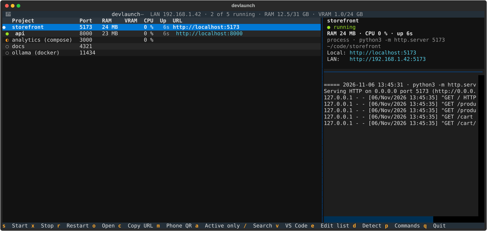

# devlaunch

A terminal dashboard for the projects you run locally. Start and stop dev servers, Docker
containers and docker compose stacks from one list, and see at a glance what's running, on
which port, how much RAM, VRAM and CPU it uses, and its logs.



I built it because I keep a dozen side projects around (web apps, model servers, bots), and
I kept losing track of which ones were still running, which port each one used, and why
something new wouldn't start.

## What it does

- **One list for every kind of project.** A command (`npm run dev`, `uv run app`), a single
  Docker container, or a whole compose project.
- **It finds them for you.** `devlaunch detect` scans your project folders and guesses the
  command and port from `package.json` scripts, Vite and Next.js defaults, `pyproject.toml`
  entry points, and FastAPI, Flask, Streamlit or Gradio apps. It also picks up running
  containers that publish ports.
- **Port clashes are caught before they happen.** If the port is taken, devlaunch tells you
  by what: another project, a container or some other process. If it's another project, it
  offers to stop it first.
- **Your phone is one keypress away.** It shows the LAN URL and a QR code you can scan from
  your phone. If a server only listens on `127.0.0.1`, it says so and tells you which flag
  makes it listen on the network.
- **RAM, VRAM and CPU per project,** summed over the whole process tree (`npm` → `node` →
  `esbuild`…) or over a compose project's containers. VRAM comes from `nvidia-smi` when
  there is an NVIDIA GPU.
- **Logs and crash alerts.** Output goes to a log file you can read in the side panel. If
  something you started dies, you get a notification with the last lines.
- **Dependencies.** `depends = ["ollama"]` starts the model server before the app that
  needs it.
- **Processes outlive the dashboard.** Close it and your servers keep running. When it
  opens again, it finds them by their saved pid or by the port they listen on.

## Install

Linux, Python 3.12+ and [uv](https://docs.astral.sh/uv/):

```bash
uv tool install git+https://github.com/WinCode143/devlaunch
devlaunch detect ~/code     # scan a folder and write the project list
devlaunch                   # open the dashboard
```

Docker, `nvidia-smi` and VS Code's `code` command are optional. When one is missing, its
column or action simply does nothing.

Keys: `Enter` start/stop · `s` start · `x` stop · `r` restart · `o` open in the browser ·
`c` copy URL · `m` QR code for your phone · `a` active only · `/` search · `v` open in VS Code ·
`e` edit the list · `d` detect · `p` command palette · `q` quit.

## The CLI

```bash
devlaunch list              # status and URLs
devlaunch list --json       # the same as JSON, with RAM/VRAM/CPU, for scripts
devlaunch up storefront     # start it (and what it depends on), warning about port clashes
devlaunch down storefront
devlaunch logs api -n 50
devlaunch url storefront    # local and LAN URLs
devlaunch detect [FOLDER…]  # add new projects; existing entries are never overwritten
```

Both outputs of `list` are meant to be read by other programs. I use them from a separate
tool that starts and stops my projects on request. The text format is one line per project,
`<●|◐|○> <id> <port|—> [url] [notes]`, and it stays the same between versions. The JSON is a
list of objects:

```json
{"id": "storefront", "name": "storefront", "kind": "process", "port": 5173,
 "running": true, "partial": false, "detail": "",
 "urls": ["http://localhost:5173", "http://192.168.1.42:5173"],
 "usage": {"ram_mb": 24.1, "vram_mb": 0, "cpu": 0.0, "since": 1762437931.2}}
```

`usage` is `null` for stopped projects. `since` is the start time in epoch seconds.

## Configuration

Everything lives in `~/.config/devlaunch/projects.toml`. `detect` creates it, and `e` opens
it in your `$EDITOR`.

```toml
[settings]
roots = ["~/code", "~/work"]       # what `detect` and the `d` key scan

[project.storefront]
name = "storefront"
dir = "~/code/storefront"
command = "npm run dev -- --host"
port = 5173

[project.chat-ui]
name = "Chat UI"
dir = "~/code/chat-ui"
command = "uv run chat-ui"
port = 8765
path = "/app"                      # appended to the URL
env = { MODEL = "llama3.1" }
depends = ["ollama"]

[project.ollama]
name = "ollama (docker)"
kind = "docker"                    # command = container name
command = "ollama"
port = 11434

[project.analytics]
name = "analytics (compose)"
kind = "compose"                   # command = compose project name, dir = where the compose file is
command = "analytics"
dir = "~/code/analytics"
port = 3000
```

`DEVLAUNCH_CONFIG` and `DEVLAUNCH_STATE` move the config folder and the state folder
(logs and pids, `~/.cache/devlaunch`) somewhere else.

To get a launcher entry in your desktop's application menu:

```bash
cp data/devlaunch.desktop ~/.local/share/applications/
cp data/devlaunch.svg ~/.local/share/icons/hicolor/scalable/apps/
```

## How it works

Some details that took more than one try:

- **Telling “running” from “someone else is on the port”.** A process project counts as
  running if devlaunch started it and that pid is still alive. Before trusting a pid, it
  also checks the process's start time, because the kernel reuses pids. A project also
  counts as running if something listens on its port, but only when that port doesn't
  belong to another project's process tree or to a container's `docker-proxy`. Otherwise
  two projects configured on port 3000 would both show as running.
- **Partial compose projects.** A compose project counts as up only when its service
  answers. That means a live container publishes the main port, or, for projects without a
  port, that every container is up. If only the database is alive, the project shows as
  `◐ partial: only db`, and `down` still stops whatever is running.
- **Processes are started in their own session** (`setsid`) with output going to a log
  file. That's why they survive the dashboard closing, and why `stop` can signal the whole
  process group. Without that, `npm run dev` would die while its `node` child kept the port.
- **CPU percentages need two readings.** psutil reports 0% the first time it sees a
  process, so the dashboard keeps its `Process` objects between refreshes, and
  `list --json` measures twice, 0.3 s apart.
- **Everything slow runs in worker threads:** `docker ps`, `nvidia-smi` and walking the
  process table. The UI stays responsive with dozens of projects.

```
src/devlaunch/
  __init__.py    CLI (argparse); no arguments opens the TUI
  app.py         Textual app: table, detail panel, logs, dialogs, QR
  processes.py   status, start/stop, port clashes, usage, Docker
  detect.py      project discovery
  config.py      projects.toml
```

## Development

```bash
uv sync
uv run pytest
uv run ruff check .
```

The tests start real HTTP servers on free ports to check status, clashes, logs and
`stop`. They fake Docker's output for the compose cases, and drive the TUI with Textual's
test pilot.

## Limitations

- Linux only. It relies on `bash -lc`, process groups and psutil's view of listening
  sockets, which needs no root for your own processes on Linux.
- Ports are matched by number only. Two servers on the same port but different addresses
  are treated as a clash.
- Detection is heuristic. Review the list after `detect`; anything it couldn't infer gets
  a note.

## License

MIT
